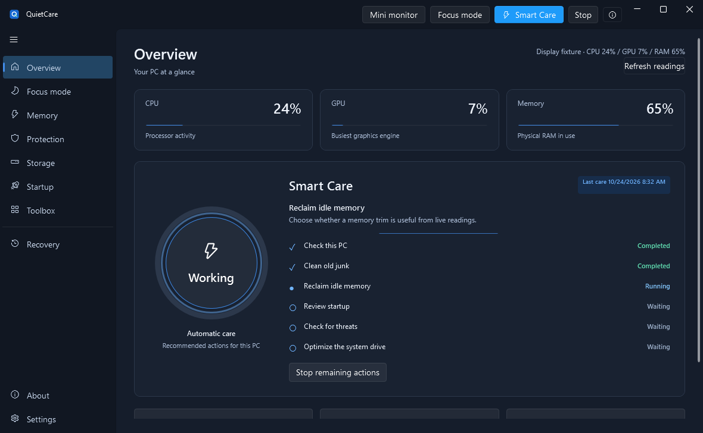
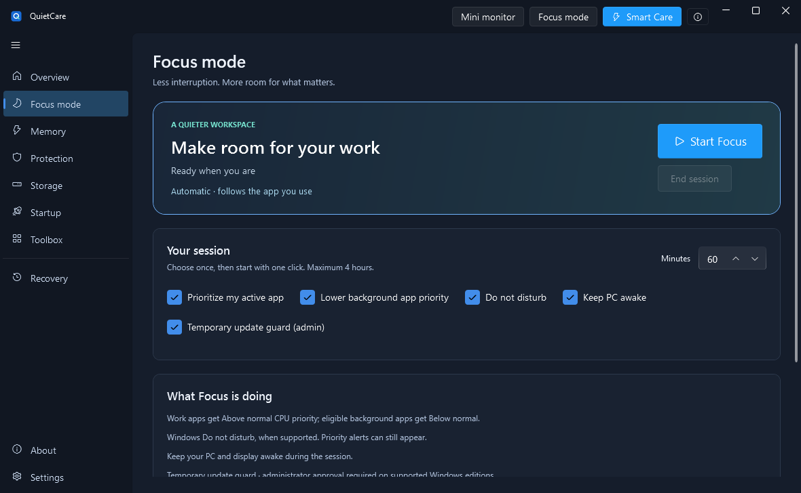

# QuietCare

A Windows PC-care workspace with a tiny transparent CPU / GPU / RAM monitor, a dedicated Focus mode, automatic Smart Care, guarded RAM Boost, one-click junk cleanup, Microsoft Defender scan controls, disk tools, and startup-change notifications.

**0.7.0-preview.1 · Windows x64 · unsigned preview**

[Download the preview](https://github.com/EhosanurRahmanRomi/QuietCare/releases/tag/v0.7.0-preview.1) · [Source and licenses](THIRD-PARTY-NOTICES.md) · [Validation](docs/VALIDATION.md) · [Security](SECURITY.md)


The screenshots render the actual WPF controls with explicitly labeled display fixtures. The compact monitor preview also uses demonstration readings.



The step screenshot shows labeled fixture outcomes; it does not represent a completed Windows scan or drive operation.

## Start using it

1. Download **QuietCare-Setup.exe** from the release and open it. This is a real installer with an embedded native MSI package and the .NET runtime included.
2. Leave **Start the mini monitor when I sign in to Windows** checked. Setup installs the permanent app, Start menu entries, optional desktop shortcut, app icon and Windows uninstaller for your account.
3. The **tiny transparent CPU → GPU → RAM monitor is the priority**. Its lightning button runs RAM Boost directly. Use **Mini monitor** in the app header to show it again, or the Start menu's **QuietCare Performance Monitor** shortcut.
4. Open **Focus mode** and click **Start Focus** to prioritize your active app, reduce background contention, request Do not disturb, keep the PC awake and optionally guard updates for a bounded session. [Exact behavior and restoration](docs/FOCUS-MODE.md).
5. Use **Overview → Start care** for automatic care with live stages, or Memory, Protection, Storage, Startup and Toolbox for individual tools. No categories need to be selected for Smart Care.

Closing the main window leaves the tray and monitor running. Use **Exit** in the tray menu to stop them. To change sign-in behavior, refresh speed or opacity, right-click the monitor and open its settings. Uninstall through **Windows Settings → Apps → Installed apps → QuietCare**. Settings, Recovery and startup backups are retained. [Installation details](docs/INSTALLATION.md).


The Process Monitor tab and its synchronous polling backend were removed after a user-reported freeze. The tiny CPU/GPU/RAM monitor remains.

The lightning button runs RAM Boost immediately. The chevron expands details. A result panel appears next to the floating monitor and closes automatically. Last results persist across restarts. Right-click exposes refresh speeds from 100 to 10,000 ms, transparency, startup and the last Boost result.

## What works in this preview

The shell has been rebuilt around a central care action and live stages, with dedicated Memory, Protection and Storage pages, a compact Startup table, an organized Toolbox and matching About/Settings screens. The original Q icon is used consistently in the window, executable, tray, Start menu and setup. Page fades are brief and honor reduced-motion settings.

| Area | Behavior |
| --- | --- |
| Focus mode | Timed foreground-app priority, eligible background priority reduction, optional Windows Do not disturb, keep awake and temporary update policies; owned changes restored at the end |
| Performance monitor | CPU, GPU and RAM readings; transparent native compact view, expanded detail view, adjustable speed, position and opacity |
| Smart Care | One click checks live conditions, cleans old junk, trims idle memory when useful, reviews startup changes, runs a due Defender quick scan and performs due Windows drive optimization when on power and the PC is not busy; live steps, Stop, persisted results |
| RAM Boost | Expanded idle-app check, up to 24 accepted trims (32 under high memory pressure); protects foreground work, audio, system and excluded processes; reports actual available-RAM change and per-process outcomes after a three-second follow-up |
| Safe junk cleanup | One click scans, revalidates and permanently removes eligible old temporary files and closed-browser disposable caches; live status and result counts |
| Advanced cleanup | Category previews with approved-file identity checks and recoverable quarantine; restore and explicit permanent deletion in Recovery |
| Virus checking | Starts the installed Microsoft Defender quick or full scanner through Windows UAC; displays actual exit status and links to Protection history |
| Disk optimization | Runs the Microsoft-signed Windows optimizer with `/O`, letting Windows choose the media-appropriate operation |
| Startup manager | Registry, startup folders, logon/boot tasks and automatic-service inventory; reversible current-user sign-in toggles with backups |
| Startup alerts | Persisted baseline and change history; registry/folders every 30 seconds, tasks/services every 5 minutes while running; Windows tray notifications |
| Services | State, startup type, executable and host-memory inventory; privileged changes use the Windows Services console |
| Installed apps | Inventory and Windows Installed Apps management; registry uninstall commands are not executed automatically |
| File tools | Disk tree/treemap, SHA-256 duplicates, large files, log finder and folder comparison |
| Maintenance | Restricted DNS-cache flush and Windows component cleanup; registry inspection is read-only |
| Updates | Manual GitHub release check and release notes; downloads and replacement remain manual |

See [automatic-care rules](docs/SMART-CARE.md) for the exact thresholds, exclusions and per-tool behavior. Smart Care uses local decision rules, not an external AI model. It starts only when clicked.

## Focus mode



A dedicated workspace with remembered options, a session timer, real status and recovery. It preserves open tabs/projects and keeps the mini monitor available. Windows still needs resources; Focus does not promise exclusive CPU/GPU/RAM. [Behavior](docs/FOCUS-MODE.md) · [GitHub source review](docs/FOCUS-SOURCE-REVIEW.md).

## Defender controls

Protection now includes **Keep real-time scanning off**, **Restore protection**, **Lower scan CPU** and **Restore scan settings**. Changes require Windows administrator approval and a separate confirmation. The persistent local off policy is available on supported unmanaged Windows editions when Tamper Protection is already off. Actual Windows state is checked after each request; no tamper bypass or background enforcement is used. [Behavior and limitations](docs/DEFENDER-CONTROLS.md).

## Meter readings

CPU measures processor busy time using Windows `GetSystemTimes`; it can differ from Task Manager’s frequency-adjusted CPU utility. RAM shows Windows’ approximate physical-memory load and available bytes. GPU is the busiest Windows GPU engine across adapters, not a sum of independent engines or a single selected adapter. Missing CPU/GPU counters display **—**, rather than a false zero. Sampling windows, rounding and driver support affect comparisons. The monitor uses your selected refresh interval; the main Overview limits visual updates to once per second.

## Limits that matter

- RAM Boost trims eligible **resident working sets**. It does not close tabs or free their allocations. Memory can return when an app uses it; a reduction is not guaranteed.
- Automatic cleanup has a seven-day age floor, skips running browsers and excludes session/offline data. It targets disposable caches, not documents or installed programs. Advanced developer-cache removal can require downloads or rebuilds.
- Automatic cleanup permanently deletes its own approved junk. Advanced cleanup moves files to Recovery, which does not reclaim their disk space until you explicitly delete them there.
- Defender provides malware detection and remediation. QuietCare does not contain an independent antivirus engine. A successful scanner exit is not a guarantee that a PC is malware-free. Antivirus/optimization progress shows real stages and elapsed time, not an invented percentage.
- Startup alerts cover the enumerated locations, not every persistence mechanism. Changes are checked while the app runs, not continuously while it is closed. First scans establish a quiet baseline. Windows notification settings can suppress balloons; history is retained locally.
- Service, scheduled-task and system-wide startup changes use Windows tools. Current-user sign-in items can be toggled in the app. No blanket service disabling, driver installation, registry repair or global memory-list purge is performed.
- Disk analysis is bounded to 250,000 tree items per scan and reports a partial-tree limit. Cleanup previews stop at 200,000 candidates before authorizing changes.
- This is an unsigned preview. It has fixture, render and short live-monitor evidence; broad hardware coverage and full native interaction acceptance remain incomplete. See [validation scope](docs/VALIDATION.md).

## Source, build and test

Requires the **.NET SDK 10.0.402** on Windows. Dependencies are locked to NuGet.org and signed-package verification is required.

```powershell
dotnet restore src/Cleaner.App/Cleaner.App.csproj --locked-mode
dotnet build src/Cleaner.App/Cleaner.App.csproj -c Release --no-restore
# Use a fresh empty directory for each fixture run:
dotnet run --project tests/QuietCare.Regression -c Release -- ./work/core-fixtures
dotnet run --project tests/QuietCare.BoostRegression -c Release -- ./work/boost-fixtures
```

[`build.ps1`](build.ps1) publishes the self-contained application. [`installer/build-installer.ps1`](installer/build-installer.ps1) packages the MSI and setup EXE using Python 3.12 and the Windows .NET Framework compiler; neither is required on the user’s PC. Runtime extraction on first launch needs additional disk space; download size and runtime memory are different measurements. The payload includes .NET 10 and WPF. Download size is not a feature or quality score.

The starting application is an attributed [PowerClean](https://github.com/fgilde/PowerClean) derivative. BCUninstaller startup-state handling is adapted with its Apache-2.0 notice. The other reviewed repositories informed design and policy choices; their engines were not combined or silently bundled. See the [original source comparison](docs/SOURCE-REVIEW.md) and the [four-project Focus review](docs/FOCUS-SOURCE-REVIEW.md), including the attributed optional QuietHours interface.

Application settings, local startup commands, logs and recovery metadata are stored under `%LOCALAPPDATA%\QuietCareNext`. They stay on the PC. The optional release check contacts GitHub only when clicked. [Privacy and security details](SECURITY.md).
