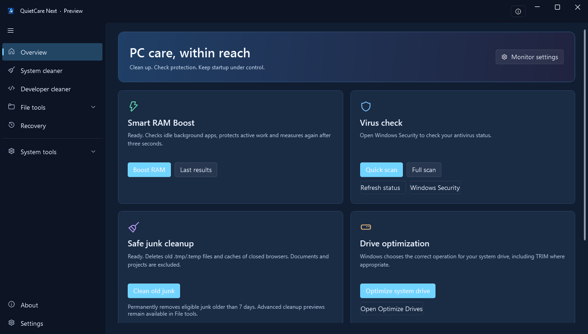

# QuietCare Next

A Windows PC-care workspace with a tiny transparent CPU / GPU / RAM monitor, guarded RAM Boost, one-click junk cleanup, Microsoft Defender scan controls, disk tools, and startup-change notifications.

**0.5.0-preview.2 · Windows x64 · unsigned preview**

[Download the preview](https://github.com/EhosanurRahmanRomi/QuietCare/releases/tag/v0.5.0-preview.2) · [Source and licenses](THIRD-PARTY-NOTICES.md) · [Validation](docs/VALIDATION.md) · [Security](SECURITY.md)



The screenshot renders the production controls. The separate monitor preview uses demonstration readings.

## Start using it

1. Download **QuietCareNext-portable-win-x64.zip** and extract it. The folder contains **QuietCare.Next.exe** plus the licenses and guide from the preview release. It includes the .NET runtime; no separate runtime installation is needed.
2. Put it in a permanent folder you control, then run it. This preview has separate settings and leaves QuietCare 0.3 installed.
3. Use the home actions directly. Advanced tools are in the sidebar.
4. To start the mini monitor when signing in, open **Monitor settings → Start QuietCare Next monitor when I sign in**. Startup is off until you enable it.

Keep the executable at that location while startup is enabled. Closing the main window leaves the tray and monitor running. Use **Exit** in the tray menu to stop them.


The Process Monitor tab and its synchronous polling backend were removed after a user-reported freeze. The tiny CPU/GPU/RAM monitor remains.

The lightning button runs RAM Boost immediately. The chevron expands details. A result panel appears next to the floating monitor and closes automatically. Last results persist across restarts. Right-click exposes refresh speeds from 100 to 10,000 ms, transparency, startup and the last Boost result.

## What works in this preview

| Area | Behavior |
| --- | --- |
| Performance monitor | CPU, GPU and RAM readings; transparent native compact view, expanded detail view, adjustable speed, position and opacity |
| RAM Boost | Selects eligible idle background processes; protects foreground work, audio, system and excluded processes; reports actual available-RAM change and per-process outcomes after a three-second follow-up |
| Safe junk cleanup | One click scans, revalidates and permanently removes eligible old temporary files and closed-browser disposable caches; live status and result counts |
| Advanced cleanup | Category previews with approved-file identity checks and recoverable quarantine; restore and explicit permanent deletion in Recovery |
| Virus checking | Starts the installed Microsoft Defender quick or full scanner through Windows UAC; displays actual exit status and links to Protection history |
| Disk optimization | Runs the Microsoft-signed Windows optimizer with `/O`, letting Windows choose the media-appropriate operation |
| Startup manager | Registry, startup folders, logon/boot tasks and automatic-service inventory; reversible current-user sign-in toggles with backups |
| Startup alerts | Persisted baseline and change history; registry/folders every 30 seconds, tasks/services every 5 minutes while running; Windows tray notifications |
| Services | State, startup type, executable and host-memory inventory; privileged changes use the Windows Services console |
| Installed apps | Inventory and Windows Installed Apps management; registry uninstall commands are not executed automatically |
| File tools | Disk tree/treemap, SHA-256 duplicates, large files, log finder and folder comparison |
| Maintenance | Restricted DNS-cache flush and Windows component cleanup; registry inspection is read-only |
| Updates | Manual GitHub release check and release notes; downloads and replacement remain manual |

## Limits that matter

- RAM Boost trims eligible **resident working sets**. It does not close tabs or free their allocations. Memory can return when an app uses it; a reduction is not guaranteed.
- Automatic cleanup has a seven-day age floor, skips running browsers and excludes session/offline data. It targets disposable caches, not documents or installed programs. Advanced developer-cache removal can require downloads or rebuilds.
- Automatic cleanup permanently deletes its own approved junk. Advanced cleanup moves files to Recovery, which does not reclaim their disk space until you explicitly delete them there.
- Defender provides malware detection and remediation. QuietCare does not contain an independent antivirus engine. A successful scanner exit is not a guarantee that a PC is malware-free. Antivirus/optimization progress shows real stages and elapsed time, not an invented percentage.
- Startup alerts cover the enumerated locations, not every persistence mechanism. Changes are checked while the app runs, not continuously while it is closed. First scans establish a quiet baseline. Windows notification settings can suppress balloons; history is retained locally.
- Service, scheduled-task and system-wide startup changes use Windows tools. Current-user sign-in items can be toggled in the app. No blanket service disabling, driver installation, registry repair or global memory-list purge is performed.
- Disk analysis is bounded to 250,000 tree items per scan and reports a partial-tree limit. Cleanup previews stop at 200,000 candidates before authorizing changes.
- This is an unsigned preview. It has fixture, render and short live-monitor evidence; broad hardware coverage and full native interaction acceptance remain incomplete. See [validation scope](docs/VALIDATION.md).

## Source, build and test

Requires the **.NET SDK 10.0.402** on Windows. Dependencies are locked to NuGet.org and signed-package verification is required.

```powershell
dotnet restore src/Cleaner.App/Cleaner.App.csproj --locked-mode
dotnet build src/Cleaner.App/Cleaner.App.csproj -c Release --no-restore
# Use a fresh empty directory for each fixture run:
dotnet run --project tests/QuietCare.Regression -c Release -- ./work/core-fixtures
dotnet run --project tests/QuietCare.BoostRegression -c Release -- ./work/boost-fixtures
```

[`build.ps1`](build.ps1) publishes the self-contained executable. Runtime extraction on first launch needs additional disk space; download size and runtime memory are different measurements. The executable is larger than the previous .NET Framework app because it includes .NET 10 and WPF, not because of padding.

The starting application is an attributed [PowerClean](https://github.com/fgilde/PowerClean) derivative. BCUninstaller startup-state handling is adapted with its Apache-2.0 notice. The other reviewed repositories informed design and policy choices; their engines were not combined or silently bundled. See the [seven-source comparison](docs/SOURCE-REVIEW.md).

Application settings, local startup commands, logs and recovery metadata are stored under `%LOCALAPPDATA%\QuietCareNext`. They stay on the PC. The optional release check contacts GitHub only when clicked. [Privacy and security details](SECURITY.md).
