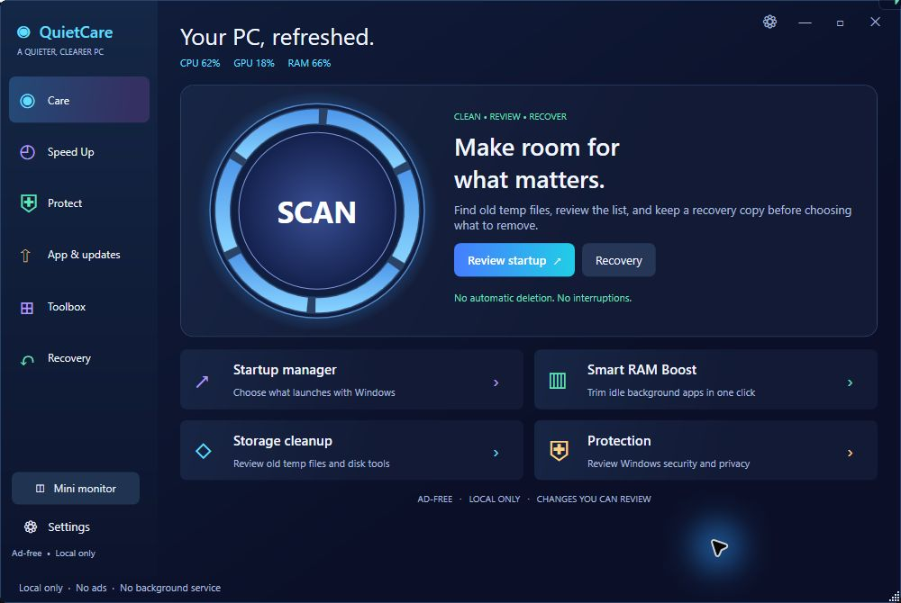

<p align="center"></p>

<p align="center">
  <a href="https://github.com/EhosanurRahmanRomi/QuietCare/releases/tag/v0.2.0"></a>
  
  
  <a href="LICENSE"></a>
  <a href="https://github.com/EhosanurRahmanRomi/QuietCare/actions/workflows/windows.yml"></a>
</p>

<p align="center"><strong>A tiny monitor when you need a glance. Clear maintenance tools when you need to act.</strong></p>
<p align="center"><a href="#download">Download</a> · <a href="docs/USER-GUIDE.txt">User guide</a> · <a href="docs/FEATURES.md">Features</a> · <a href="docs/ARCHITECTURE.md">Architecture</a> · <a href="docs/VALIDATION.md">Validation</a> · <a href="CONTRIBUTING.md">Contribute</a></p>

QuietCare is an original, ad-free Windows desktop utility built with C# and WPF. It combines a transparent CPU/GPU/RAM monitor, guarded one-click working-set trimming, startup management, and recoverable cleanup in a local-first interface. There are no accounts, advertisements, telemetry uploads, bundled drivers, or background services.

> **Preview status:** v0.2.0 is unsigned and has limited hardware coverage. It has not received an independent security audit. Some tools open Windows' own settings and consoles; QuietCare is not an antivirus or a complete Advanced SystemCare Pro replacement.

## A clearer desktop



The main interface uses a continuous navy canvas, transparent window controls, compact sidebar navigation, and focused action cards. The screenshot is the running native application, not a concept render.

### The monitor stays small


The captured strip is **205 × 28 px**. Its width follows its contents. Readings stay in **CPU → GPU → RAM** order; drag to move, expand for disk/network details, or right-click for refresh and transparency settings.

## What it does

| Capability | Behavior |
| --- | --- |
| Transparent monitor | Adjustable 100–10,000 ms refresh, transparency, topmost mode, expandable details, and sign-in startup. |
| Direct Smart RAM Boost | The floating lightning button checks qualifying idle background processes and trims their working sets without opening a chooser. |
| Startup manager | Review startup entries; back up, disable, and restore current-user Run entries without overwriting restore collisions. |
| Recoverable temp cleanup | Preview eligible old user-temp files, quarantine selected files, restore them, or confirm permanent deletion. |
| File discovery | Read-only large-file and SHA-256 duplicate-content finders with bounded work and cancellation. |
| System toolbox | Hardware/app inventory, power-plan recovery, CSV export, and 37 fixed Windows maintenance entry points. |

See the [feature matrix](docs/FEATURES.md) for the distinction between implemented tools, Windows integrations, and unavailable features.

## Download

**[Get the v0.2.0 Windows preview](https://github.com/EhosanurRahmanRomi/QuietCare/releases/tag/v0.2.0)**

| Asset | Use |
| --- | --- |
| [QuietCare-Setup.exe](https://github.com/EhosanurRahmanRomi/QuietCare/releases/download/v0.2.0/QuietCare-Setup.exe) | Per-user installer with Start menu shortcuts and an uninstaller. |
| [QuietCare.exe](https://github.com/EhosanurRahmanRomi/QuietCare/releases/download/v0.2.0/QuietCare.exe) | Portable application. Put it in its final location before enabling startup. |
| [QuietCare-source-v0.2.0.zip](https://github.com/EhosanurRahmanRomi/QuietCare/releases/download/v0.2.0/QuietCare-source-v0.2.0.zip) | The tagged source, documentation, tests, and images. |
| [SHA256SUMS.txt](https://github.com/EhosanurRahmanRomi/QuietCare/releases/download/v0.2.0/SHA256SUMS.txt) | File integrity checksums; these do not replace a code signature. |

Requires **Windows 10/11 x64** and **.NET Framework 4.8 or later**. Installation and normal use do not request administrator access. Windows may show an unsigned-application warning; review the source and provenance before deciding whether to run it. QuietCare does not automatically uninstall another product.

## RAM Boost, explained honestly

Boost uses Microsoft's documented `EmptyWorkingSet` API. It asks Windows to reduce resident pages in eligible idle background processes; it does not terminate, suspend, or restart applications or discard/reload browser tabs.

The current application family, active browser family, active audio/calls, Windows processes, visible applications, and common developer, trading, Office, terminal, VM, and media tools are excluded. Add your own protected process names in Settings. If media activity cannot be verified, Boost leaves candidates unchanged. Work is capped, with a 30-second cooldown.

Working-set trimming does not deallocate an application's data. Pages can return when needed and can cause paging latency. Lower displayed RAM use is **not a guaranteed speed improvement**. QuietCare cannot identify the contents of individual browser tabs, so it protects the whole active browser family. [Read the policy and limits](docs/RAM-BOOST.md).

## Built to stay quiet

Compact mode collects CPU/GPU/RAM only; disk and network discovery starts with the expanded monitor. The main UI is built when opened and released on close to tray. Sampling pauses when both windows are hidden, when only a minimized main window remains, and during suspension.

Local measurements on one i5-8350U / Intel UHD 620 / 16 GB PC, with about 20 seconds per case after a 5-second warmup:

| Refresh | Total CPU | Working set |
| --- | ---: | ---: |
| 1,000 ms | 0.146% | 96.9 MB |
| 250 ms | 0.703% | 97.7 MB |
| 100 ms | 1.601% | 99.8 MB |

The main UI stayed unconstructed in these runs. Fully hidden polling was disabled. These are short local observations under other active workloads, not guaranteed bounds or long-duration/battery results. [Method, raw data, and limits](docs/PERFORMANCE.md).

## Build and test

No NuGet/npm restore or separate SDK is required. In **Windows PowerShell**, from the repository root:

```powershell
.\build.ps1
.\test.ps1
.\test-ui.ps1
.\package.ps1
.\test-installer.ps1
```

The scripts use Windows' bundled .NET Framework 64-bit C# compiler. Binaries are written to `build/`; isolated fixtures stay in `test-runs/`, which is ignored by Git. See [BUILDING.md](docs/BUILDING.md) for prerequisites, expected output, CI coverage, and benchmark instructions.

The v0.2.0 local suite passed **42 core + 20 UI + 4 installer checks**. A live memory test trims only a dedicated helper process and verifies all 96 MB of its data afterward. The native UI was reviewed on the reference PC. These are scoped checks, not a claim that every app, GPU, browser, or Windows configuration is verified. [Evidence and test scope](docs/VALIDATION.md).

## For developers

```text
src/                 WPF shell, telemetry, maintenance services and native interop
installer/           Per-user installer and uninstaller
tests/               Core, WPF layout, installer and benchmark harnesses
docs/                Guides, design notes, screenshots and sanitized evidence
scripts/             Repository hygiene checks
.github/             Windows CI and contribution templates
```

Start with the [architecture](docs/ARCHITECTURE.md), [security model](docs/SECURITY-MODEL.md), [contribution guide](CONTRIBUTING.md), and [roadmap](docs/ROADMAP.md). Bug reports and focused pull requests are welcome. Please report vulnerabilities privately using the [security policy](SECURITY.md).

## Inspiration and license

The user's UI reference informed the circular scan and tiny transparent monitor. Research included [TrafficMonitor](https://github.com/zhongyang219/TrafficMonitor), [TaskbarStats](https://github.com/ericbruggema/TaskbarStats), [DevToys](https://github.com/DevToys-app/DevToys), [Microsoft PC Manager](https://pcmanager.microsoft.com/en-us), and documented Windows APIs. See [research and design decisions](docs/RESEARCH.md) for details and review-rating limitations.

QuietCare's code, branding, and vector interface are original. No referenced application's code or binaries are bundled. It is not affiliated with IObit, Microsoft, or the referenced projects.

**[MIT licensed](LICENSE)** · Maintained by [@EhosanurRahmanRomi](https://github.com/EhosanurRahmanRomi)
