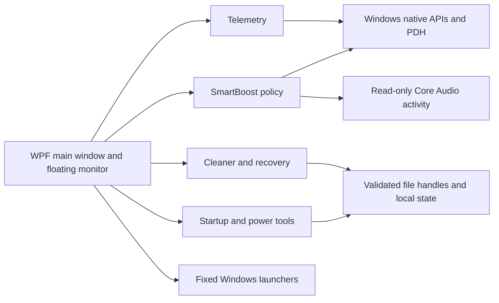

# Architecture

QuietCare is a single-process C#/.NET Framework 4.8 Windows application. WPF renders the main window and layered floating monitor; a small WinForms notification icon provides tray access. The installer is a separate per-user WinForms executable embedding the application payload.

## Source map

| File | Responsibility |
| --- | --- |
| `src/Program.cs` | Entry point, per-user single-instance mutex, local reveal signal and application lifetime. |
| `src/UI.cs` | Theme, navigation, integrated window controls, scan UI, transparent monitor, sampling scheduling and direct Boost wiring. |
| `src/UI.Care.cs`, `src/CareScan.cs` | Live read-only multi-category scanning, progress, cancellation and result review. |
| `src/UI.Boost.cs` | Last Boost measurements, protected/failed outcomes and result review. |
| `src/UI.Updates.cs`, `src/Updates.cs` | User-controlled app updates, release policy, verified bounded downloads and guarded installer launch. |
| `src/Telemetry.cs` | CPU/system memory sampling, GPU engine aggregation and demand-only disk/network counters. |
| `src/SmartBoost.cs` | Candidate model, protection policy, host abstraction, foreground history, capped asynchronous Boost orchestration. |
| `src/AudioActivity.cs` | Read-only Core Audio session/process enumeration and COM lifetime management. |
| `src/Native.cs` | Narrow native interop for counters, memory, process identity, file handles, power plans and window styles. |
| `src/Storage.cs` | XML settings/state, path/handle boundaries, cleanup quarantine/recovery and read-only file finders. |
| `src/Startup.cs` | Startup inventory, backup/disable/restore of current-user Run entries and app inventory. |
| `src/Tools.cs` | Fixed allowlisted Windows entry points, system information and power-plan selection/recovery. |
| `installer/Setup.cs` | Embedded-payload verification, per-user install/shortcuts/registration and guarded uninstall. |

## UI and telemetry lifetime

The main shell is lazy on tray startup and is released on close to tray. A dispatcher timer samples at the selected interval, skipping overlapping reads. CPU/GPU/RAM are collected for compact mode. Disk/network detail is sampled only when the widget is expanded; network discovery/rate work is additionally cached/throttled. Labels update when values change, and secondary summaries update at most once a second.

The sampling policy stops the timer when neither the main window nor monitor needs visible data and during suspension. The main window uses `WindowChrome` and transparent overlaid caption controls; the layered floating window uses per-pixel alpha and a non-activating extended style. Static gradients avoid a perpetual animation loop.

The app installs a WPF dispatcher synchronization context explicitly because the WinForms tray can otherwise change the default async continuation context. Lifetime guards prevent background sensor/Boost completions from updating an exiting window.

## Mutations and recovery

The cleaner previews a narrow old-temp policy. Selected files are revalidated through locked parent paths and native handles, then renamed into same-drive quarantine. Restore refuses destination collisions; stale or changed recovery content is rejected. Permanent deletion requires an explicit confirmation in the app.

Startup backups preserve literal command strings and registry types before removing current-user Run values. Restore does not overwrite an existing value. Power-plan selection saves an original plan for recovery. These are independent operations, not a full transactional system snapshot.

## Boundaries

No remote server, listening socket, plugin loader, driver, background service or downloaded script runner is implemented. User-controlled HTTPS release checks/downloads are documented in [UPDATES.md](UPDATES.md); they have no silent installation. Windows tool launches are fixed and use trusted system paths. Registry-discovered app uninstall commands are displayed as inventory, not executed. See the [security model](SECURITY-MODEL.md) for limits.

## Test harnesses

Core and installer tests use isolated fixture directories/registry entries. The live RAM test filters the native host to a dedicated helper PID. WPF layout tests use an injected Boost host and inspect the real controls. The benchmark compiles the production sources with a separate entry point. None of these harnesses grants the production installer a test-root override.
